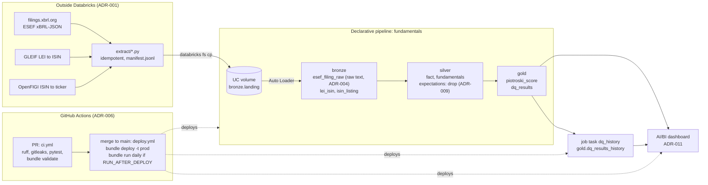

# piotroski-eu-lakehouse

Piotroski F-scores for every Danish company that files an ESEF annual report. The scores are built from free xBRL filings in a medallion lakehouse on Databricks Free Edition, deployed by GitHub Actions through a Declarative Automation Bundle.

> **Not financial advice.** This is a data-engineering portfolio project. The scores come from automated parsing of public filings, may be wrong or incomplete (see [Known limitations](#known-limitations)), and are not a recommendation to buy or sell any security.

## Problem

The [Piotroski F-score](https://en.wikipedia.org/wiki/Piotroski_F-score) (Piotroski, 2000) rates a company's financial strength from 0 to 9. It adds up nine yes/no tests on profitability, leverage and liquidity, and operating efficiency. Commercial data vendors sell the score. This project derives it from the source instead: the machine-readable annual reports that EU-listed companies must publish in ESEF format.

The project covers Denmark only (ADR-002). Denmark had the most error-free ESEF filings on [filings.xbrl.org](https://filings.xbrl.org) for the last two fiscal years. Everything runs on Databricks Free Edition, so the design works within its limits: serverless compute only, restricted egress, and no REST catalog creation.

## Architecture



- **Extract** runs on a PC or a GitHub runner, not in the workspace (ADR-001). It only lands files, and a re-run downloads nothing new.
- **Bronze** stores each filing as one text column. xBRL facts are a map keyed by fact ID, so schema inference would create thousands of columns (ADR-004).
- **Silver** parses facts with `from_json`, keeps non-dimensional consolidated totals, and maps IFRS concepts to canonical fields ([src/piotroski/concepts.py](src/piotroski/concepts.py)). It ends with one row per LEI and fiscal year. The newest filing wins when a year is restated.
- **Gold** computes the nine signals ([src/piotroski/signals.py](src/piotroski/signals.py)) and the DQ rules ([src/piotroski/dq.py](src/piotroski/dq.py)). Business logic lives in `src/piotroski/` as `DataFrame -> DataFrame` functions that are unit-tested locally and shipped to the pipeline as a wheel (ADR-010). The files in `pipelines/` only wire them together.
- **Environments**: one catalog per target, `piotroski_dev` and `piotroski_prod` (ADR-003). Only CI deploys prod.

## Results

The ten highest-scoring companies with all nine signals available, latest fiscal year. Data: dev catalog, 2026-10-19 (same code as prod).

| Company | Ticker | FY | F-score | ROA | CFO | ΔROA | Accrual | ΔLever | ΔLiquid | No equity issue | ΔMargin | ΔTurnover |
| --- | --- | --- | ---: | :-: | :-: | :-: | :-: | :-: | :-: | :-: | :-: | :-: |
| Ambu A/S (B) | AMBUB | 2025 | 9 | 1 | 1 | 1 | 1 | 1 | 1 | 1 | 1 | 1 |
| Gubra A/S | GUBRA | 2025 | 9 | 1 | 1 | 1 | 1 | 1 | 1 | 1 | 1 | 1 |
| Zealand Pharma A/S | ZEAL | 2025 | 9 | 1 | 1 | 1 | 1 | 1 | 1 | 1 | 1 | 1 |
| ALK-Abelló A/S | ALKB | 2025 | 8 | 1 | 1 | 1 | 1 | 0 | 1 | 1 | 1 | 1 |
| Brd. Klee (B) | KLEEB | 2025 | 8 | 1 | 1 | 1 | 1 | 1 | 1 | 1 | 0 | 1 |
| Flügger Group A/S | FLUGB | 2025 | 8 | 1 | 1 | 1 | 1 | 0 | 1 | 1 | 1 | 1 |
| GreenMobility A/S | GREENM | 2025 | 8 | 1 | 1 | 1 | 1 | 0 | 1 | 1 | 1 | 1 |
| H. Lundbeck A/S (A) | HLUNA | 2025 | 8 | 1 | 1 | 1 | 1 | 1 | 0 | 1 | 1 | 1 |
| MT Højgaard Holding | MTHH | 2025 | 8 | 1 | 1 | 1 | 0 | 1 | 1 | 1 | 1 | 1 |
| Novonesis (B) | NSISB | 2025 | 8 | 1 | 1 | 1 | 1 | 1 | 0 | 1 | 1 | 1 |

Ties are sorted by name. A company with several share classes is shown under its first listing by ISIN; `gold.piotroski_score` keeps all of them in a `listings` array (ADR-008).

**Coverage**

- `gold.piotroski_score` has **815** rows (LEI × fiscal year) for **302** LEIs, fiscal years 2022–2025.
- **245** rows have all nine signals. About half of the other 570 are first years (297): they have no prior year for the five change signals, so they score at most 4 (ADR-005).
- **89 of 315** ESEF LEIs have a Nasdaq Copenhagen common-stock listing. The others are scored anyway, without a ticker.

**Data quality, latest run** (`gold.dq_results`)

| Rule | Checked | Failed | % failed |
| --- | ---: | ---: | ---: |
| `balance_identity`: Assets = Equity + Liabilities within 1% | 731 | 9 | 1.23 |
| `duplicate_conflicts`: LEI-year with a conflicting duplicate fact, nulled in silver (ADR-009) | 815 | 7 | 0.86 |
| `unmapped_leis`: ESEF LEI with no row in `silver.fundamentals` (interim-only filers, expectation drops) | 315 | 13 | 4.13 |
| `listing_coverage`: LEI without a listing | 315 | 226 | 71.75 |
| `all_signals_available`: row with fewer than 9 signals | 815 | 570 | 69.94 |

Each run appends these rows, plus the silver expectation drop counts from the pipeline event log, to `gold.dq_results_history`. The dashboard plots that history.

## Signals

Each signal is 1, 0 or **null**. Null means an input was missing; it never counts as 0 (ADR-005). `f_score` is the sum of the non-null signals, `signals_available` counts them, and `data_completeness = signals_available / 9`. That way a reader can tell a weak company from a company with missing data.

| Column | 1 when | Inputs |
| --- | --- | --- |
| `f_roa` | ROA > 0 | profit / assets |
| `f_cfo` | operating cash flow > 0 | CFO |
| `f_delta_roa` | ROA rose | ROA, t and t−1 |
| `f_accrual` | CFO > profit | CFO, profit |
| `f_delta_lever` | non-current liabilities / assets fell | ADR-007 proxy for long-term debt |
| `f_delta_liquid` | current ratio rose | current assets / current liabilities |
| `f_eq_offer` | no proceeds from issuing shares (a filed cash-flow statement without a proceeds line counts as none) | ADR-007 |
| `f_delta_margin` | gross margin rose | gross profit, or revenue − cost of sales |
| `f_delta_turn` | asset turnover rose | revenue / assets |

## How to run

**Prerequisites:** Python 3.12, [uv](https://docs.astral.sh/uv/), Java 17 (for local PySpark tests), the Databricks CLI (v1.21+), and a Databricks Free Edition workspace logged in with `databricks auth login`.

**1. Tests and lint**

```bash
uv sync
uv run pytest
uv run pre-commit run --all-files
```

**2. Extract** (runs locally; writes to the gitignored `data/landing/`)

```bash
uv run python -m extract.esef_filings   # ESEF filings + manifest.jsonl; skips files already downloaded
uv run python -m extract.gleif_isin     # LEI -> ISIN
uv run python -m extract.openfigi       # ISIN -> ticker; optional OPENFIGI_API_KEY
```

**3. One-off workspace bootstrap for dev** (ADR-003: catalog creation fails over REST on Free Edition, so it is SQL)

```sql
CREATE CATALOG IF NOT EXISTS piotroski_dev
```

```bash
databricks schemas create bronze piotroski_dev   # likewise silver, gold
databricks volumes create piotroski_dev bronze landing MANAGED
extract/upload_to_volume.sh piotroski_dev
```

**4. Deploy and run in dev**

```bash
databricks bundle validate -t dev
databricks bundle deploy -t dev
databricks bundle run daily -t dev    # pipeline refresh -> dq_history
```

**Prod** is deployed only by CI. A PR runs `ci.yml`, and a merge to `main` runs `deploy.yml` (`bundle deploy -t prod`, then `bundle run daily` when the repository variable `RUN_AFTER_DEPLOY` is `true`) as a service principal with OAuth M2M (ADR-006). In prod, the bundle owns the schemas and the landing volume. The one-off bootstrap order is in ADR-003; the service principal also needs *Can use* on the SQL warehouse for the dashboard (ADR-011).

## Known limitations

- **One country.** `concepts.py` is tuned on Danish filers. A second country will bring new extension tags.
- **No price data.** Piotroski applied the score to high book-to-market stocks. Without market cap this is the raw score over all filers, not his screen.
- **Definitions differ from the paper.** Ratios use end-of-year assets, not beginning-of-year. Long-term debt is proxied by non-current liabilities (ADR-005, ADR-007).
- **Coverage depends on filings.xbrl.org**, which doesn't hold every filing. Concepts that aren't mapped become null signals, not errors.
- **Tickers are best-effort.** Only 89 of 315 LEIs map to a Copenhagen common-stock listing via GLEIF and OpenFIGI (ADR-008).
- **Extraction is manual.** The scheduled `extract.yml` was cut from the MVP. When it returns, it must read `manifest.jsonl` from the volume first, or a fresh runner re-downloads everything.
- **No FX conversion.** All signals are ratios within one company's own currency, so DKK and EUR filers compare fine. Absolute amounts in silver are not comparable across currencies.

## Architecture decisions

| ADR | Decision |
| --- | --- |
| [001](docs/adr/001-extraction-outside-databricks.md) | Extraction runs outside Databricks |
| [002](docs/adr/002-country-choice.md) | Country choice: Denmark |
| [003](docs/adr/003-environment-isolation.md) | One Unity Catalog catalog per target |
| [004](docs/adr/004-bronze-raw-text.md) | Bronze stores raw xBRL-JSON as text |
| [005](docs/adr/005-null-signals.md) | Missing input is a null signal; signal definitions |
| [006](docs/adr/006-ci-auth.md) | CI authenticates as a service principal with OAuth M2M |
| [007](docs/adr/007-debt-proxy-and-equity-issuance.md) | Long-term debt proxy and equity-issuance definition |
| [008](docs/adr/008-ticker-source-openfigi.md) | Ticker source: OpenFIGI mapping of GLEIF ISINs |
| [009](docs/adr/009-silver-fact-selection.md) | Silver fact selection rules |
| [010](docs/adr/010-src-as-wheel.md) | `src/piotroski` shipped as a versioned wheel |
| [011](docs/adr/011-dashboard-as-code.md) | The AI/BI dashboard is a bundle resource |

The plan, with what comes after the MVP (prices, more scores, a second country), is in [docs/PLAN.md](docs/PLAN.md).

## Disclaimer

This repository and its outputs are for educational and demonstration purposes only and do not constitute financial, investment or tax advice. No warranty is given that the data or scores are accurate, complete or current. Do your own research or consult a licensed adviser before making investment decisions.

## Licence

MIT. Filing data comes from filings.xbrl.org, GLEIF and OpenFIGI under their own terms. None of it is committed to this repository.
